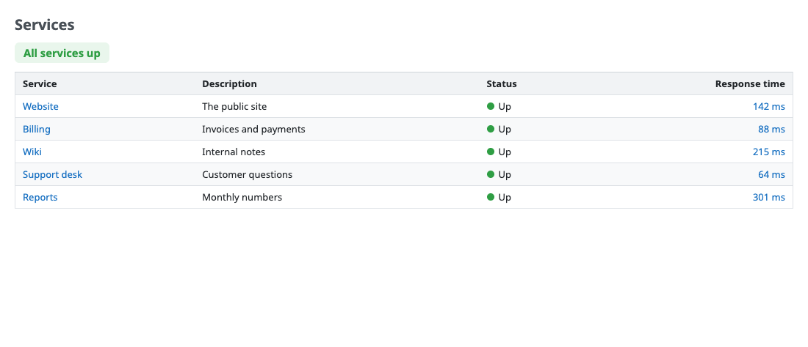
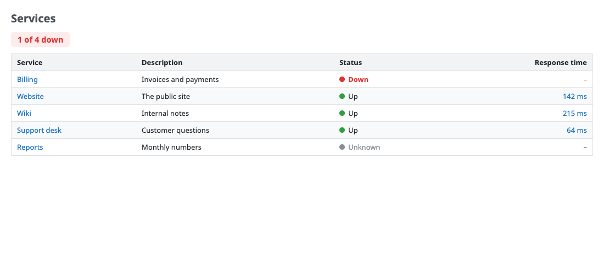
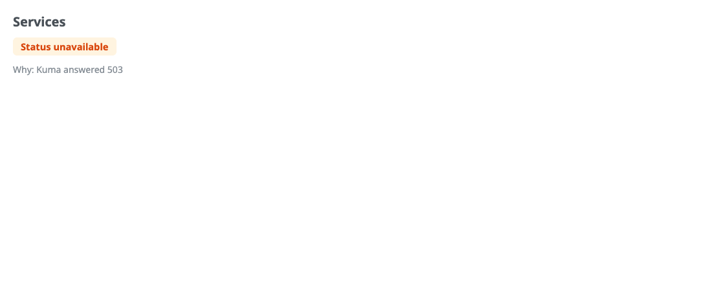
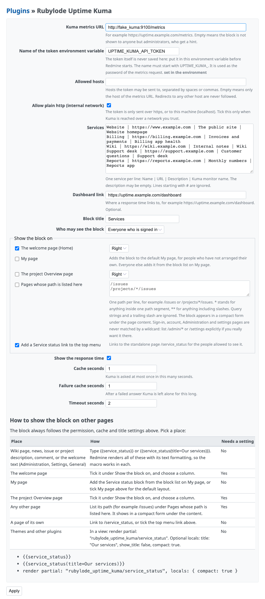
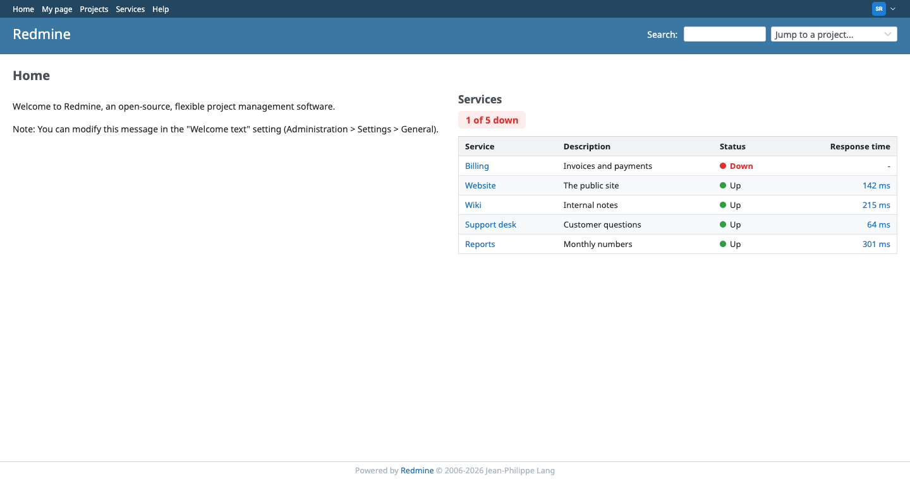
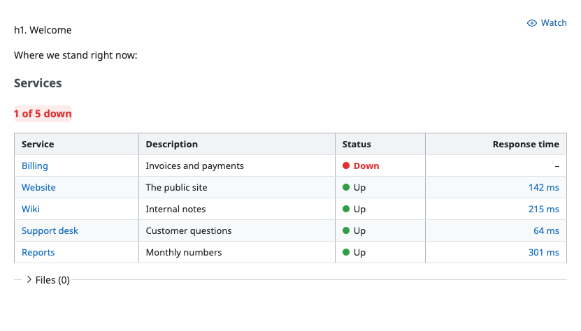

# Rubylode Uptime Kuma

<p></p>

[](https://github.com/rubylode/redmine-rubylode-uptime-kuma/actions/workflows/tests.yml)
[](https://github.com/rubylode/redmine-rubylode-uptime-kuma/actions/workflows/security.yml)
[](https://github.com/rubylode/redmine-rubylode-uptime-kuma/tags)
[](https://github.com/rubylode/redmine-rubylode-uptime-kuma/blob/main/LICENSE)


A plugin for Redmine 5.1 or newer that shows the live status of your services, read from [Uptime Kuma](https://github.com/louislam/uptime-kuma), as a block. It can go on the welcome page, My page, the project Overview, under any page you list, in a wiki page or on a page of its own.

Only the services you list are shown, under the names you choose. Services that are down come first, a summary line says "All services up" or "1 of 5 down", and each row can show Kuma's latest response time. When Kuma cannot be reached the block says "Status unavailable" and the page around it renders as usual. Kuma is asked once per cache window, not once per page view.







## Install

1. Copy this folder to `plugins/redmine_rubylode_uptime_kuma` in your Redmine, or clone it there: `git clone https://github.com/rubylode/redmine-rubylode-uptime-kuma.git redmine_rubylode_uptime_kuma`.
2. Set the token in the environment of the Redmine process (see Security below), for example `UPTIME_KUMA_API_TOKEN`.
3. Restart Redmine.
4. Open Administration, Plugins, Rubylode Uptime Kuma, Configure. Fill in the metrics URL and the services list.

There is no migration. In Kuma, create an API key (Settings, API Keys) and use it as the token; the plugin reads `/metrics` with the key as the basic-auth password.

## Settings

Everything except the token is a plugin setting.

| Setting | Default | Meaning |
|---|---|---|
| Kuma metrics URL | empty | For example `https://uptime.example.com/metrics`. While empty, administrators see a hint and everyone else sees nothing. |
| Name of the token environment variable | `UPTIME_KUMA_API_TOKEN` | Must start with `UPTIME_KUMA_`. See Security. |
| Allowed hosts | empty | Hosts the token may be sent to. Empty means only the host of the metrics URL. |
| Allow plain http | off | Needed for `http://` to anything but this machine. See Security. |
| Services | empty | One per line: `Name \| URL \| Description \| Kuma monitor name`. Checked when you save; a bad line is reported with its number. Lines starting with `#` are ignored; an empty monitor name means the name. |
| Dashboard link | empty | Where a response time links to. Without it the time is plain text. |
| Block title | Services | The heading. |
| Show the block on | all off | The welcome page (left or right column), My page (default layout), the project Overview (left or right column), pages whose path is listed, and a top menu link. See Where the block shows. |
| Who may see the block | Everyone who is signed in | Or administrators only. |
| Show the response time | on | The last column. |
| Cache seconds | 60 | Kuma is asked at most once in this time. |
| Failure cache seconds | 30 | After a failed answer Kuma is left alone for this long. |
| Timeout seconds | 2 | Connect and read timeout for the request to Kuma. |

Example services:

```
Website | https://www.example.com | The public site | Website homepage
Billing | https://billing.example.com | Invoices and payments | Billing app health
```



## Where the block shows

| Place | How | Needs a setting |
|---|---|---|
| Wiki page, news, issue or project description, comment, the welcome text | Type `{{service_status}}` or `{{service_status(title=Our services)}}`. `{{uptime_kuma_status}}` is the same macro under a second name. | No |
| The welcome page (Home) | Tick it under "Show the block on", choose left or right. | Yes |
| My page | Add "Service status" from the block list on My page. Ticking My page in the settings also puts it into the default layout, for people who have not arranged their own. | Optional |
| The project Overview page | Tick it under "Show the block on", choose left or right. | Yes |
| Any other page | List its path under "Pages whose path is listed here". It shows in a compact form (the summary and what is down) under the page content. | Yes |
| A page of its own | `/service_status`, for signed-in people the permission setting allows (others get 403, anonymous visitors the sign-in page). Tick "Add a Service status link to the top menu" to link it. | Optional |
| Themes and other plugins | `render partial: "rubylode_uptime_kuma/service_status"`, with the optional locals `title: "Our services"`, `show_title: false` and `compact: true`. It draws nothing for a person who may not see it. | No |

Every place follows the permission, title and cache settings, and shows "Status unavailable" when Kuma cannot be reached. The same table, with the snippets, is on the settings page.

Notes:

- The welcome text (Administration, Settings, General) is rendered with Redmine's text formatting, macros included, so `{{service_status}}` works there without any setting. This is tested.
- Paths are matched against the request path: one per line, `*` stands for anything inside one path segment (`/projects/*/issues`), `**` for anything including slashes. A query string and a trailing slash are ignored. Patterns must start with `/` and are validated when you save. Sign-in, account, Administration and settings pages are never matched by a wildcard; list `/admin/*` or `/settings` itself to put the block there. Redmine has no hook above the page content, so the compact block sits under it.
- The top menu: Redmine 7 has no setting for custom top menu items (Administration, Settings, Display only configures the new-item menu), so this plugin registers its own link, switched by the setting above. A theme or another plugin can also link to `/service_status` anywhere.





## Security

The plugin sends a secret to an address an administrator typed, so it is strict about where:

- **The token is never stored.** It is read from an environment variable when the request is made. It is not in the database, not rendered in any page (the settings page only says whether the variable is set), not logged, and scrubbed from error messages.
- Only `UPTIME_KUMA_*` variables can be named. The setting cannot point the plugin at `SECRET_KEY_BASE` or a database password. Another name is rejected on save, and ignored at run time (the token counts as missing and no variable is read).
- The token is bound to a host. It is sent only to the host of the metrics URL, or, when you fill in Allowed hosts, only to a host on that list (the metrics URL must then be on it too). Any other destination is refused before a request is made.
- Redirects are never followed, so a redirect cannot carry the credentials to another host.
- https is required, except for this machine (`localhost`, `127.0.0.1`, `::1`) or when an administrator ticks "Allow plain http". Basic auth over plain http can be read by anyone on the path, so tick it only for a network you trust.
- Who sees the block is a setting, and the status of services can be limited to administrators.

## Theming and dark mode

Every colour and size is a CSS custom property on `.rubylode-service-status`; set them in your theme. Defaults follow Redmine 7's own `--oc-*` colours where they exist. In dark mode (the system setting, or a theme that marks `data-theme="dark"`, `data-color-scheme="dark"` or `body.dark`) the dark values below apply.

| Property | Default (light) |
|---|---|
| `--rubylode-uptime-kuma-text` | `var(--oc-gray-9, #212529)` |
| `--rubylode-uptime-kuma-text-muted` | `var(--oc-gray-6, #6b7480)` |
| `--rubylode-uptime-kuma-border` | `var(--oc-gray-3, #dee2e6)` |
| `--rubylode-uptime-kuma-header-background` | `var(--oc-gray-1, #f1f3f5)` |
| `--rubylode-uptime-kuma-row-hover-background` | `var(--oc-gray-0, #f8f9fa)` |
| `--rubylode-uptime-kuma-up-color` | `var(--oc-green-8, #2b8a3e)` |
| `--rubylode-uptime-kuma-up-background` | `#e9f6ec` |
| `--rubylode-uptime-kuma-down-color` | `var(--oc-red-8, #c92a2a)` |
| `--rubylode-uptime-kuma-down-background` | `#fdecec` |
| `--rubylode-uptime-kuma-unknown-color` | `var(--oc-gray-6, #868e96)` |
| `--rubylode-uptime-kuma-unavailable-color` | `var(--oc-orange-9, #a15c07)` |
| `--rubylode-uptime-kuma-unavailable-background` | `#fff4e0` |
| `--rubylode-uptime-kuma-link-color` | `var(--oc-blue-8, #1b4f80)` |
| `--rubylode-uptime-kuma-dot-size` | `10px` |
| `--rubylode-uptime-kuma-radius` | `6px` |
| `--rubylode-uptime-kuma-gap` | `12px` |
| `--rubylode-uptime-kuma-summary-font-size` | `1.05em` |

## Try it

```
ruby bin/demo up          # Redmine 7 on http://localhost:3012 and a fake Kuma on http://localhost:9112
ruby bin/demo scenario one_down     # all_up, one_down, mixed (one down, one unknown), unavailable
ruby bin/demo down
```

Sign in as `admin` / `admin` (sees the settings and the hints) or `sam.rivera` / `demo-password-1`. The fake Kuma is `test/support/fake_kuma_server.rb`: Prometheus text like Kuma's `/metrics`, with the token required as the basic-auth password. `npm install && npm run screenshots` retakes the screenshots.

## Troubleshooting

- A cache problem never breaks the page. If the cache store cannot be read or written (a cache file owned by another user, a full disk), the plugin logs a warning with the error class and message, treats it as an empty cache and fetches live; the page still answers.

## Tests

```
ruby bin/test                                 # whole suite, in a Redmine 7 Docker image
ruby bin/test test/unit/service_status_test.rb
```

Minitest. The integration tests start the fake Kuma on a local port, including two of them to prove the token never reaches a second host.

Replacing an in-house block: see [docs/replacing-an-in-house-block.md](docs/replacing-an-in-house-block.md).

Pull Requests are welcome!

## Releasing

Push a `vX.Y.Z` tag whose version matches `version` in `init.rb` and has an entry in `CHANGELOG.md`. CI runs the tests, builds `redmine_rubylode_uptime_kuma-X.Y.Z.zip` and publishes the GitHub release with the changelog entry as its notes. To build a release for a tag that already exists, use Actions, release, Run workflow.

The text to paste when listing the plugin on www.redmine.org, and how to read the result of Check for updates, is in [docs/redmine-org-listing.md](docs/redmine-org-listing.md).

## License

GPL v2 or later, the same as Redmine. See `LICENSE`.

Copyright (C) 2026  Nick Gorbikoff. Each Ruby file carries the same short notice Redmine puts on its own.

The fallback colours in the stylesheet are [Open Color](https://github.com/yeun/open-color) values (MIT). The notice is in `NOTICE.md`.

No warranty, as the GPL says. The plugin only reads from Kuma and stores no token, but try it on a copy of your tracker first.
